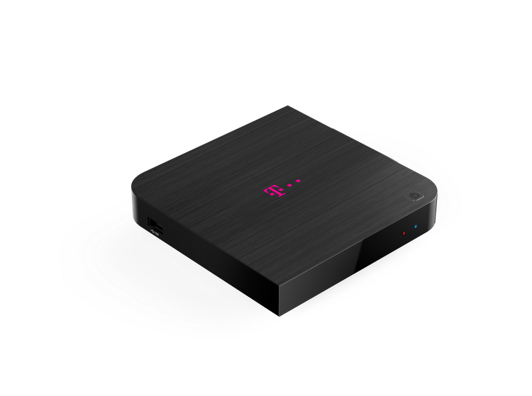
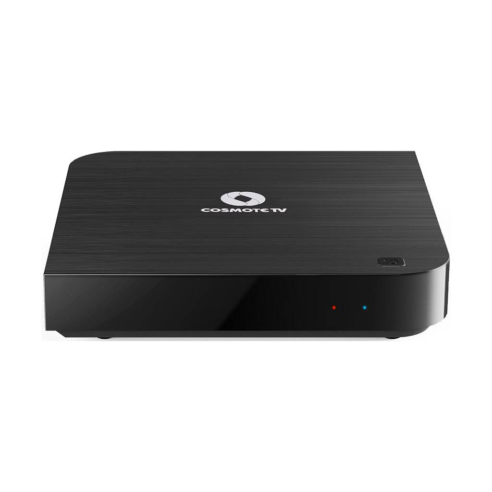

# KaonMedia KSTB6077

A reverse-engineered hardware manual and bare-metal ARM code for the
KaonMedia KSTB6077, an Android TV set-top box built on the Broadcom BCM7268
SoC. Broadcom publishes no datasheet for this chip; everything here was
tested on the board or says where it came from.

**Start here: [the manual](docs/README.md)**: table of contents,
conventions and safety rules.

<p align="center">
  
  
</p>

The KSTB6077 is supplied to several TV operators, so the logo on the lid
varies by provider (Telekom and COSMOTE TV shown).

## What I achieved

- **A hardware manual for a chip with no public datasheet**: every block from the memory map to the 3D
  GPU, each one tested on the board or marked with where it came from
- **My own firmware on the box**: kboot (a fail-safe loader with an EL3 monitor) and kmon (a monitor
  with an HDMI console, USB keyboard, networking and eMMC files), autostarted by the stock BOLT
- **Doom on bare metal**, with HDMI video, sound, a USB keyboard and the IR remote
- **Mainline arm64 Linux** started from kmon, with Alpine on a repartitioned eMMC and a GPU-accelerated
  desktop

## The story in short

1. **[The stock box](docs/01-stock-firmware.md).** The untouched firmware: boot chain, partitions,
   the stock kernel, and Android 11 over `adb`.
2. **[BOLT, the bootloader](docs/02-bolt.md).** Broadcom's bootloader, its commands sorted by risk,
   and its own code taken apart.
3. **[Running my own code](docs/03-running-code.md).** Reaching `BOLT>`, loading programs over serial,
   USB and TFTP, and starting them in 64-bit mode at EL2 or EL3.
4. **[The hardware, one block at a time](hardware/HARDWARE.md).** Probe programs against every block,
   with [the stock drivers as a guide](docs/04-stock-drivers.md) where Broadcom's code was available.
5. **[kmon](extras/mon/README.md) and [Doom](extras/doom/README.md).** A monitor that BOLT starts on its
   own, and Doom running on it.
6. **[kboot](bootloader/kboot/README.md).** A loader that picks the golden kmon or an update, and
   falls back after failed starts, so a bad update can't brick the box.
7. **[Repartitioning the eMMC](docs/05-storage-repartition.md).** Room for bare-metal data files and a
   Linux root file system.
8. **[Mainline Linux](port/README.md).** arm64 Linux on top of my own firmware, with Alpine, the GPU
   and a desktop.

## Board

| | |
|---|---|
| Product | KaonMedia KSTB6077 (Android TV 8.0 set-top box) |
| Board name | `KM_SH368AT` (PCB silkscreen: "DT-DVB-T Android TV rev1.0") |
| SoC | Broadcom **BCM7268 B0**, chip ID `72680010` |
| CPU | 4× Broadcom Brahma-B53 (Cortex-A53, **ARMv8-A**), 1656 MHz, 1 MB L2 |
| RAM | 2 GB **LPDDR4** (one Samsung K4F6E3S4HM-MGCJ, 16 Gbit ×32) at 1856 MHz, at physical address `0x00000000` |
| Storage | 7.28 GiB eMMC: user area, two 4 MB boot partitions, 4 MB RPMB |
| Firmware | BOLT v1.34 bootloader, BSP 4.2.5, ARM Trusted Firmware BL31, PSCI v0.2 |

## Features

Each row links to the chapter that describes it.


| Function | Hardware | Where |
|---|---|---|
| Serial console | UART0, 16550-compatible, 115200 8N1, at `0xf040c000`; 5-pin header on the PCB | [`docs/03-running-code.md`](docs/03-running-code.md) |
| More UARTs | UART1 `0xf040d000`, UART2 `0xf040e000`: 16550, 81 MHz clock, working (loopback-tested), unused by BOLT; pins unknown | [`hardware/uart.md`](hardware/uart.md) |
| Ethernet | GENET v5 at `0xf0480000`, internal BCM7268 PHY (ID `0xae025091`), 100 Mbit/s full duplex (10/100 PHY). After BOLT the MAC is idle with no address. kmon has its own polled driver: DHCP, ping both ways, TFTP get/put at ~1.9 MB/s | [`hardware/ethernet.md`](hardware/ethernet.md) |
| Wi-Fi | Broadcom **BCM43570** on PCIe (`14e4:aa31`, chip `0xaa32`); power switched by AON GPIO 21 and 26 | [`docs/01-stock-firmware.md`](docs/01-stock-firmware.md) |
| Bluetooth | Broadcom USB adapter `0a5c:2045` | |
| USB | 5 host controllers at `0xf0b00300–0xf0b01000` (2× EHCI, 2× OHCI, xHCI); one USB-A port = EHCI1/OHCI1, internal BT = EHCI0/OHCI0. Controllers are reset by `go`, PHY stays up: OHCI1 driven from EL2: control and interrupt transfers, a HID keyboard (kmon, Doom) and a USB stick enumerated | [`hardware/usb.md`](hardware/usb.md) |
| Video | HDMI, driven by the Broadcom display pipeline (no open driver). BOLT's boot splash sets it up (from the `flash0.splash` partition; re-added on the modified box) and leaves a **1920 × 1080 RGB565 framebuffer** (surface register `0xf0641048`), which stays live after `go -64`; `load -splash` redraws it with any BMP. The display's register-DMA (RDC) runs a custom list from RAM: background colour, window size and position tested | [`hardware/display.md`](hardware/display.md) |
| 3D GPU | Broadcom V3D 3.3 at `0xf1200000` (hub) / `0xf1208000` (core), 8 QPUs, behind power island `0xf041d020`; driven from EL2: TFU job, render jobs into the framebuffer, a binner job and a shaded triangle | [`hardware/gpu.md`](hardware/gpu.md) |
| 2D blitter | M2MC at `0xf09b0000`: fill, copy, scaling, 8-bit palette lookup; 320 × 200 → 1600 × 1000 onto the screen in 1.65 ms | [`hardware/2d-blitter.md`](hardware/2d-blitter.md) |
| Audio | HDMI, 48 kHz 32-bit stereo from a looping DRAM buffer. BOLT's splash starts it from a `pcm0` in `flash0.splash` but skips the HDMI audio clock at 1080p; three register writes (N/CTS) make it audible. Keeps running after `go -64` | [`hardware/audio.md`](hardware/audio.md) |
| Data storage | `flash0.splash` past 1 MB holds a large file that BOLT loads into RAM before `go` (~15 MB/s); now holds a 14.4 MB file. On the modified box a 2 GB FAT32 `DATA` partition holds files that kmon reads and writes (~33 / 12.5 MB/s), and a 5.2 GB ext4 `ROOT` holds Linux (Alpine) | [`hardware/storage.md`](hardware/storage.md) |
| TV tuner | DVB-T tuner with RF input | |
| Power LED (LED1) | green = AON GPIO 18, red = AON GPIO 17; active-low; both on = orange | [`hardware/gpio.md`](hardware/gpio.md) |
| Blue LED (LED3) | AON GPIO 16, active-low | [`hardware/gpio.md`](hardware/gpio.md) |
| Standby button (SW1) | AON GPIO 14, active-low | [`hardware/gpio.md`](hardware/gpio.md) |
| Recovery / BT-pairing button (SW4) | AON GPIO 7, active-low; held at power-on → recovery; in Android → Bluetooth remote pairing | [`hardware/gpio.md`](hardware/gpio.md) |
| Power switch (SW2) | hard power switch | |
| IR receiver (IR1) | IR receiver block channel kbd1 at `0xf0419900`; enabled as an NEC decoder from EL2, it receives all keys of the Kaon remote (custom code `0x0820`). BOLT leaves it off | [`hardware/ir.md`](hardware/ir.md) |
| I2C | 5 BSC controllers (`0xf040a300`, `0xf0419a80/b00/b80`, `0xf040a400`); bus scan from EL2: ch0 = HDMI DDC (EDID `0x50`, HDCP `0x3a`), ch3 = device at `0x67` (Si2168C demodulator per Nexus) | [`hardware/i2c.md`](hardware/i2c.md) |
| Temperature sensor | AVS TMON at `0xf04d1500`, °C = (410040 − code × 487) / 1000 | [`hardware/system-blocks.md`](hardware/system-blocks.md) |
| Seconds counter | wake timer at `0xf041a080`, 27 MHz clock | [`hardware/system-blocks.md`](hardware/system-blocks.md) |
| Watchdog | `0xf040a6a8`, 27 MHz ticks | [`hardware/system-blocks.md`](hardware/system-blocks.md) |
| Software reset | SUN_TOP_CTRL `0xf0404304` / `0xf0404308` | [`hardware/system-blocks.md`](hardware/system-blocks.md) |
| Reset-surviving memory | 1 KB AON SRAM at `0xf0410200` | [`hardware/system-blocks.md`](hardware/system-blocks.md) |
| Interrupt controller | ARM GIC-400 (GICv2) at `0xffd01000`, 256 interrupt IDs, 4 CPU interfaces, fed by Broadcom L2 controllers; all SPIs are non-secure (group 1). Taken at EL2 with `HCR_EL2.IMO` = 1: timer, UART0, SW1, IR remote tested | [`hardware/interrupts.md`](hardware/interrupts.md) |
| CPU timer | ARM generic timer, 27 MHz | [`hardware/system-blocks.md`](hardware/system-blocks.md) |
| CPU cores | 4 × Brahma-B53; `go -64` runs core 0, PSCI `CPU_ON` starts cores 1–3 at EL2 (tested) | [`hardware/cpu-cores.md`](hardware/cpu-cores.md) |

## CPU modes

- BOLT runs in 32-bit mode (AArch32 SVC, non-secure) with its MMU and caches
  on. The EL3 secure monitor (`smm64`, PSCI v0.2) lives at `0x06400000`.
- `go` starts a program in AArch32 under BOLT's MMU. Peripherals are then
  reachable only in `0xf0000000–0xf12fffff`; the GIC (`0xffd…`) is unmapped,
  and accessing it hangs the board.
- `go -64` starts a program in **AArch64 at EL2**, and `boot -64 -el3` starts
  it in **AArch64 at EL3**, as the secure monitor. Both enter with the MMU
  and caches off and no vector table, so all peripherals, including the GIC,
  are reachable at their physical addresses.

Details: [`docs/03-running-code.md`](docs/03-running-code.md), [`hardware/memory-map.md`](hardware/memory-map.md).

## Repo layout

| Path | What |
|---|---|
| [`docs/`](docs/README.md) | the manual (start here): story chapters, conventions, appendices |
| [`docs/evidence/`](docs/evidence/README.md) | probe programs, their outputs and raw console captures |
| [`docs/map/`](docs/map/index.html) | interactive SoC and board map with an address finder |
| [`hardware/`](hardware/HARDWARE.md) | the hardware chapters: memory map, registers, every block |
| [`bootloader/`](bootloader/) | [`kboot/`](bootloader/kboot/README.md) (the loader BOLT autostarts), [`boot/`](bootloader/boot/) (device trees, USB-stick autoboot script), [`assembly/`](bootloader/assembly/) (32-bit UART monitor) |
| [`extras/`](extras/) | [`mon/`](extras/mon/README.md) (kmon), [`doom/`](extras/doom/README.md) (Doom), [`c/`](extras/c/) (bare-metal C example), and the code they share: [`libc/`](extras/libc/), [`usb/`](extras/usb/), [`fat/`](extras/fat/) |
| [`port/`](port/README.md) | mainline arm64 Linux: kernel config and patches, drivers, device tree, rootfs, Mesa, GPU tests |
| [`tools/`](tools/) | build, upload, dump and analysis tools |
| [`images/`](images/) | photos of the box and the PCB |

Full layout and tool list: [`docs/README.md`](docs/README.md#repository-layout-and-tools).

**Not included:** the stock firmware files (`stock/`, downloaded by `tools/fetch-stock`) and build
outputs.

## Quick start

With the board at `BOLT>` and the serial bridge running:

```
tools/build-a64 prog.s
tools/kstb-run --a64 --watchdog 20 --wait-bolt prog.bin    # AArch64 at EL2

tools/build-c extras/c/main.c
tools/kstb-run --a64 --watchdog 60 --listen 30 --wait-bolt extras/c/main.bin   # C example

bootloader/assembly/build.sh
tools/kstb-run bootloader/assembly/bootstrap.bin                      # 32-bit monitor

tools/kstb-mon                                             # kmon monitor from flash; then 'doom'

make -C extras/doom
tools/kstb-doom                                            # Doom alone, over TFTP
```

USB-stick and TFTP loading: [`docs/03-running-code.md`](docs/03-running-code.md).
