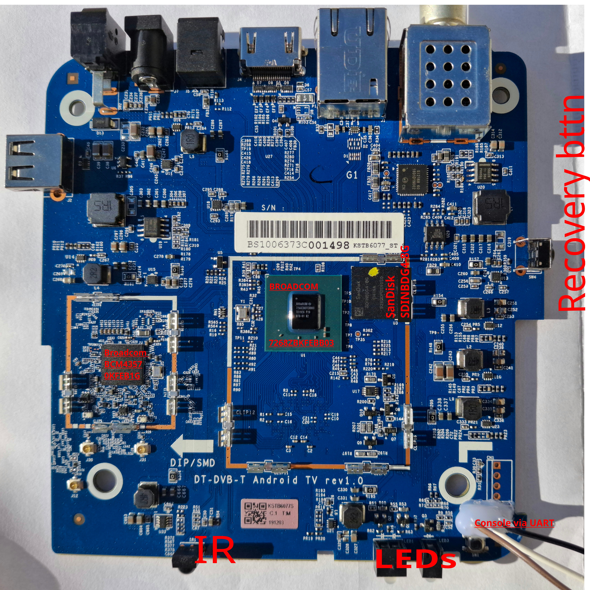
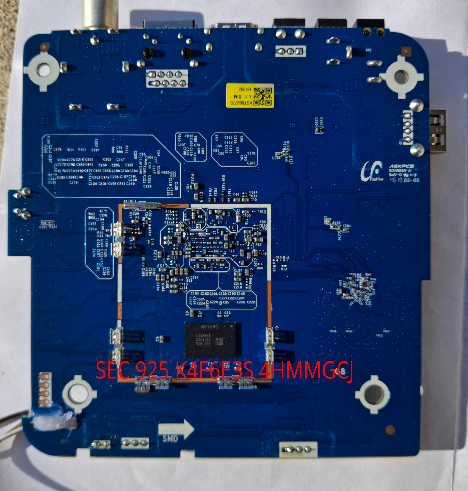

# Hardware: KaonMedia KSTB6077 (Broadcom BCM7268)

  
  

## Board

| | |
|---|---|
| Product | KaonMedia KSTB6077 (Android TV 8.0 set-top box) |
| Board name | `KM_SH368AT` (PCB silkscreen: "DT-DVB-T Android TV rev1.0") |
| SoC | Broadcom **BCM7268 B0**, chip ID `72680010` |
| CPU | 4× Broadcom Brahma-B53 (Cortex-A53, **ARMv8-A**), 1656 MHz, 1 MB L2 |
| RAM | 2 GB **LPDDR4** (one Samsung K4F6E3S4HM-MGCJ, 16 Gbit ×32) at 1856 MHz, at physical address `0x00000000` |
| Storage | 7.28 GiB eMMC: user area, two 4 MB boot partitions, 4 MB RPMB |
| Firmware | BOLT v1.34 bootloader, BSP 4.2.5, ARM Trusted Firmware BL31, PSCI v0.2 |

The feature table with every block's status is in the [top-level README](../README.md#features).
The conventions used in every chapter (how sure a statement is, notation, safety) are in
[the manual](../docs/README.md#conventions).

## System reference

| Chapter | What it covers |
|---|---|
| [Memory map](memory-map.md) | RAM layout, free RAM for programs, peripheral window, boot SRAM, what BOLT's MMU maps |
| [Register sheet](registers.md) | every register used so far on one page, and the **do-not-touch** list |
| [Peripheral blocks](peripherals.md) | every known hardware block with its address and first word; switched-off blocks; GISB error capture; the abort-safe probe |

## Hardware blocks

| Chapter | Block |
|---|---|
| [CPU cores](cpu-cores.md) | 4 × Brahma-B53; starting cores 1–3 with PSCI |
| [What EL3 sees](el3.md) | EL3 vs EL2 reads of the same registers: only the GIC and the CPU's own registers differ |
| [Interrupts](interrupts.md) | GIC-400, Broadcom L2 controllers, every interrupt by ID |
| [System blocks](system-blocks.md) | temperature, wake timer, watchdog, chip ID, software reset, reset reason, straps, OTP, AON SRAM, generic timer |
| [GPIO](gpio.md) | LEDs, buttons, pin mux |
| [UARTs](uart.md) | UART0 (console), UART1, UART2 |
| [I2C](i2c.md) | five BSC controllers, bus scan |
| [IR receiver](ir.md) | NEC decoding, the Kaon remote's codes |
| [USB](usb.md) | EHCI, OHCI, xHCI; which port is which; OHCI from bare metal |
| [Ethernet](ethernet.md) | GENET v5 and the internal PHY |
| [Storage](storage.md) | SDHCI controllers, eMMC, data files for bare-metal programs |
| [Display](display.md) | HDMI framebuffer, vsync and page flipping, display lists (RDC), compositor, graphics feeder, BOLT's splash |
| [2D blitter](2d-blitter.md) | M2MC: fill, copy, scaling, palette-8 |
| [3D GPU](gpu.md) | V3D 3.3: power, reset, TFU, render and binner jobs, QPU shaders |
| [Audio](audio.md) | HDMI audio from BOLT's splash code, S/PDIF |

## Device trees

| Chapter | What it covers |
|---|---|
| [Device tree files](device-tree.md) | which DTB in `bootloader/boot/` is original, and how they differ |
